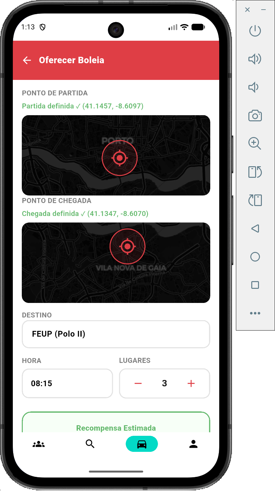

# Ride4Free — Carpooling Mobile App

     

**Ride4Free** connects drivers who have empty seats with people heading the same way. The goal is fewer half-empty cars on the road, lower travel costs and less pollution.

> Project for **Software Engineering (ES)** — BSc in Informatics and Computing Engineering (L.EIC), FEUP, 2025/2026. **Final grade: 19.8/20.**

<p align="center"></p>

## Features
- **Offer and find rides**, choosing departure and arrival points on a map (OpenStreetMap)
- **Verified profiles**, ratings and ride history for safety and trust
- **Points system** and a leaderboard that rewards drivers who share rides
- **In-app chat** and **notifications**
- University login, built for the FEUP community

## Architecture & stack
| Layer | Technology |
|---|---|
| Mobile app | **Flutter / Dart** |
| Backend API | **Python, FastAPI, Pydantic** |
| Database | **SQLite** |
| Maps | OpenStreetMap |
| Deployment | Backend exposed through **Cloudflare Tunnel**, for testing on real phones over 4G/5G |
| Quality | Unit and integration tests (Flutter + pytest), **CI with GitHub Actions** |

## Process
Developed with **Scrum** over **4 sprints**, each with planning, a review and a retrospective. The process included user stories, a domain model, mockups, user interviews and acceptance tests. Everything is documented in [`Docs/`](Docs) and in the [development report](DEVELOPMENT_REPORT.md).

## ▶ How to run
```bash
# Backend
cd backend && pip install -r requirements.txt
uvicorn main:app --reload --host 127.0.0.1 --port 8000

# App
cd Ride4Free && flutter pub get && flutter run
```

## My contribution
I was the **most active contributor** in the team:
- Main app screens and the app's integration with the API (`main.dart`, `ride4free_api.dart`)
- Backend endpoints (`backend/main.py`)
- **Unit and integration tests**, plus the test summary
- Sprint documentation, changelog and the final presentation

## Team
André Rocha · Thomas Tuerlinckx · Filipe Silva · Pedro Dinis
